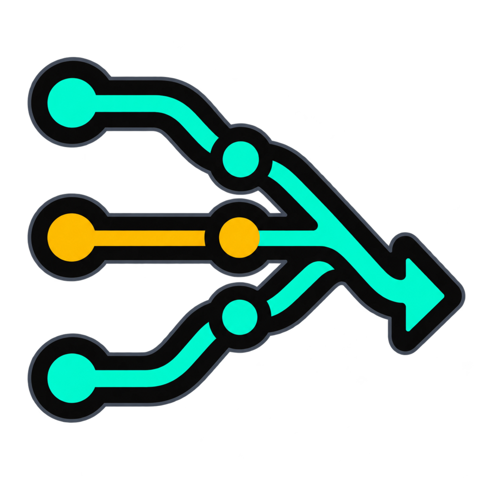

# Model Router

<p align="center">
  
</p>

A native Rust TUI and CLI that runs one task through a sequence of agent
harnesses (Codex, Claude Code, Pi, omp, Cursor, Gemini, OpenCode, Aider, Goose,
Amp, Copilot, or your own) with the model you pick for each stage. Each stage
runs unattended or in the harness's own interactive terminal, hands a
structured result to the next, and the run ends with a brief telling you what
changed, how it was verified, and what to read closely. It reuses your
harness logins, never commits unless you add a ship stage, and saves every
run so you can inspect, retry, or rerun it.

## Install

Prebuilt binaries for Linux (x86_64/aarch64, static) and macOS (x86_64/arm64)
are attached to each [GitHub release](https://github.com/Tyru5/model-router/releases).
The installer checks the SHA-256 and puts `model-router` and its `mr` alias in
`~/.cargo/bin` (`MODEL_ROUTER_INSTALL_DIR=DIR` installs to `DIR/bin`; to pin a release, use
`releases/download/vX.Y.Z/model-router-installer.sh`):

```sh
curl --proto '=https' --tlsv1.2 -LsSf https://github.com/Tyru5/model-router/releases/latest/download/model-router-installer.sh | sh
```

With Homebrew, once the tap is published: `brew install Tyru5/tap/model-router`.

From source (Rust 1.85+):

```sh
cargo install --git https://github.com/Tyru5/model-router --locked
# or, in a clone: cargo install --path . --locked, or scripts/build.sh (also symlinks mr)
```

Install and log in to the harnesses you want separately; `model-router doctor`
checks what it finds. `model-router completions zsh` (or `bash`, `fish`,
`elvish`, `powershell`; `--bin mr` for the alias) prints a shell completion
script.

## 60-second quickstart

```sh
cd /path/to/project && mr
```

The first launch opens a tour that walks these steps to a completed run;
`F1` shows or hides it.

1. `p` picks a repository (or start `mr` inside one).
2. `t` writes the task (`Ctrl+S` applies), or `f` imports a file, URL, or GitHub issue.
3. Check the stages; `e` edits one, `m` picks its model, `o` turns it on or off.
4. `r` runs. Runs (`2`) shows live output beside a sidebar of runs.
5. Interactive stages open the harness's terminal; exit it, then `a` advances.
   `Ctrl+B` detaches; quitting `mr` can leave it running for the next `mr`.
6. Read the review summary; `d` opens the diff.

The default workflow:

```text
Codex                     Claude Code / sonnet      Code review          Codex
Investigate, unattended → Implement, interactive → disabled initially → Review summary, unattended
```

Codex stages leave `model` blank to inherit your harness default. `w` adds presets such as
**Quick task**, **Bug fix**, or **Best-of-3 implement**.

## Features

- Per-stage harness, model, provider, effort, mode, and permissions → [harnesses](docs/harnesses.md)
- Fifteen stage presets and five workflow presets → [workflows](docs/workflows.md#presets)
- Stage graphs: parallel read-only stages with `after` → [workflows](docs/workflows.md#graphs-after-and-parallel-stages)
- Best-of-N fan-out in separate worktrees, with an auto or model judge → [workflows](docs/workflows.md#fan-out-best-of-n)
- Structured handoffs (schema v2, native structured output for Codex/Claude) → [workflows](docs/workflows.md#handoffs)
- Optional reviews with automatic repair passes → [workflows](docs/workflows.md#reviews-and-repairs)
- Verification gates and router-run checks → [workflows](docs/workflows.md#verification)
- Review summary brief at the end of every run → [workflows](docs/workflows.md#review-summary)
- Opt-in ship stage: commit, push, draft PR after a preview → [workflows](docs/workflows.md#shipping)
- Several runs at once, auto worktrees, detach/reattach, takeover → [tui](docs/tui.md#interactive-sessions)
- Diff view, output search, pager/editor hand-off → [tui](docs/tui.md#diff-view)
- Task imports from files, URLs, GitHub issues/PRs/files → [tui](docs/tui.md#task-import)
- OpenRouter and 20 other OpenAI-compatible providers → [harnesses](docs/harnesses.md#providers)
- Custom adapters for any CLI → [harnesses](docs/harnesses.md#custom-adapters)
- Project trust and optional OS sandbox → [safety](docs/safety.md)
- Cost estimates and budgets → [cost](docs/cost.md)
- Notifications: terminal, desktop, webhook → [tui](docs/tui.md#notifications)
- Run history, reports, compare, stats, bench → [automation](docs/automation.md)
- MCP and HTTP server for other agents → [serve](docs/serve.md)
- Delegation: a stage's agent hands tasks to other harnesses and models,
  launches runs, and schedules work you approve → [delegation](docs/delegation.md)
- Fourteen themes and optional Vim motions → [themes](docs/themes.md), [tui](docs/tui.md#vim-motions)

## Keys

| Key | Action |
| --- | --- |
| `1` `2` `3` / `Tab` | Workflow, Runs, Harnesses / next view |
| `p` | Choose repository |
| `t` / `f` | Edit task / import task |
| `←→` | Select stage |
| `e` / `c` / `m` | Edit stage / harness settings / pick model |
| `o` | Enable or disable stage |
| `a` / `x` / `J` `K` | Add / remove / move stage |
| `w` | Switch workflow or add preset |
| `r` | Run |
| `s` | Save project config |
| `↑↓` / `Enter` (Runs) | Select a run / open a saved run |
| `a` / `y` / `i` (Runs) | Advance / retry / retry interactively |
| `o` (Runs) | A finished run's brief ↔ its output |
| `t` / `Ctrl+B` | Open or take over a session / detach from it |
| `d` / `h` (Runs) | Diff / inspect handoff |
| `F1` | Getting-started tour |
| `T` / `F8` / `F9` | Theme / Vim motions / notifications |
| `Space` | Action menu: a group letter, then an action letter |
| `?` / `:` | Keyboard guide / command menu |
| `q` / `Ctrl+C` | Quit / cancel |

All keys: [docs/tui.md](docs/tui.md).

## CLI

```sh
mr -C DIR                                    # TUI on a project
model-router run --task 'Fix the cache bug'  # or --task-file F / --task-url URL
model-router run --task-file spec.md --unattended --worktree
model-router preview                         # exact commands, no model call
model-router resume RUN_ID --retry           # --advance, --model ID, --interactive
model-router history --status failed,blocked
model-router report RUN_ID --diff
model-router rerun RUN_ID
model-router fork RUN_ID --stage implement --model opus  # isolated, from a checkpoint
model-router handoffs RUN_ID --stage review   # what a stage receives, and losses
model-router apply RUN_ID --check             # apply worktree changes back uncommitted
model-router ship RUN_ID --draft-pr
model-router cost --since 7d
model-router stats --role implementation --min-pass 0.8
model-router bench examples/bench.toml --dry-run
model-router init --preset bug-fix --detect
model-router validate
model-router trust
model-router doctor
model-router completions zsh --bin mr
model-router serve --mcp
```

Every subcommand and flag: [docs/automation.md](docs/automation.md).

## Safety model

- **Your credentials, your harnesses.** The router launches each harness with
  its own login and config and stores no credentials. Provider keys are read
  from environment variables at launch and redacted in records.
- **No commits by default.** Only an enabled ship stage commits, on a new
  branch, after you confirm a preview.
- **No permission bypass by default.** Harness permissions stay native unless a
  stage overrides them.
- **Project trust.** A repository's config cannot run custom adapters, checks,
  extra arguments, loosened permissions or sandbox, or custom endpoints until
  you run `model-router trust`.
- **Optional sandbox.** Wrap any stage in bubblewrap (Linux) or
  `sandbox-exec` (macOS).
- **Clean exits.** Harness process groups end with their stage.

Details: [docs/safety.md](docs/safety.md).

## Configuration

`model-router init` writes `.model-router.toml`; `s`/`S` in the TUI save
project/global templates. Reference: [docs/configuration.md](docs/configuration.md).

## Links

- [Documentation index](docs/index.md)
- [Changelog](CHANGELOG.md)
- [Development, tests, CI](docs/development.md)
- [Related tools and ideas to borrow](docs/related.md)
- [Build specification](docs/spec.md) · [Design decisions](docs/design-interview.md)

## License

MIT. See [LICENSE](LICENSE).
